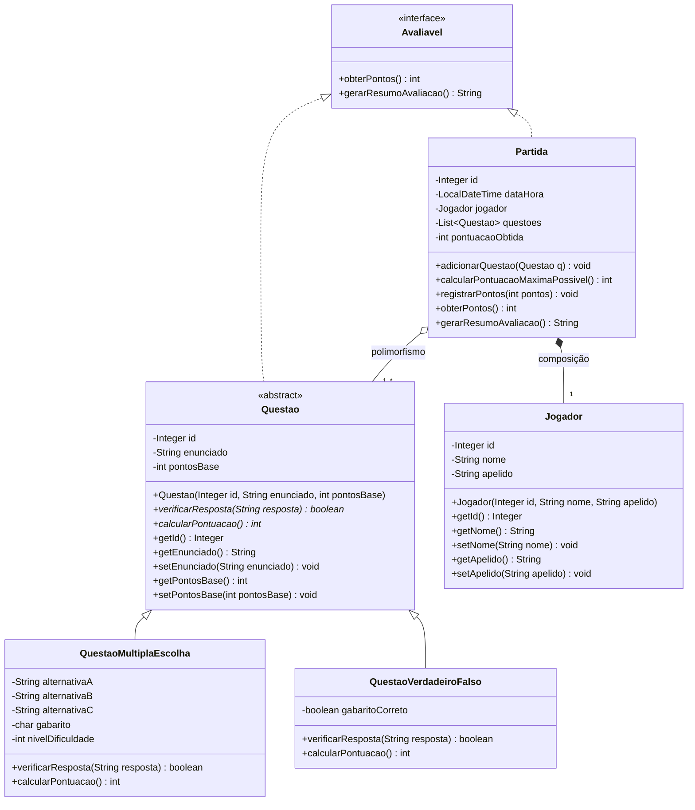

# Quiz-em-java-2026
Projeto quiz em java do 4° semestre com Linguagem Orientada ao Objeto em Java

# Sistema de Quiz com Ranking - POO 2026

Projeto Integrador N2 de Programação Orientada a Objetos.

## Integrantes
* Bruno Salvador Dias
* Paulo Lucas

## Tecnologias e Configurações
* **Linguagem:** Java 17+
* **Interface Gráfica:** Java Swing
* **Banco de Dados:** PostgreSQL (via JDBC)
* **Repositório:** https://github.com/Lucas23157/Quiz-em-java-2026

## Como Executar
1. Execute o script `banco.sql` no seu servidor PostgreSQL.
2. Duplique o arquivo `config.exemplo.properties`, renomeie para `config.properties` e preencha com suas credenciais do banco.
3. Compile e execute a classe principal no pacote `app`.

## Diagrama de Classes (Domínio)

